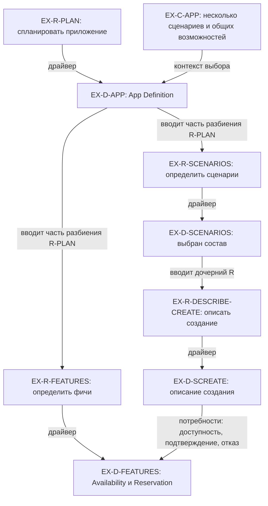
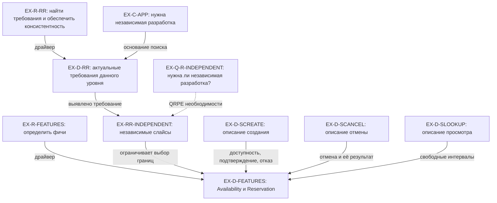
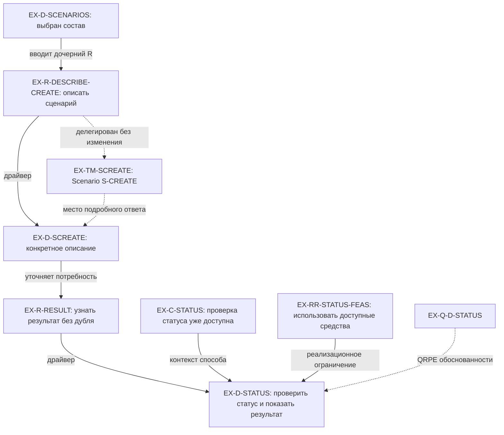
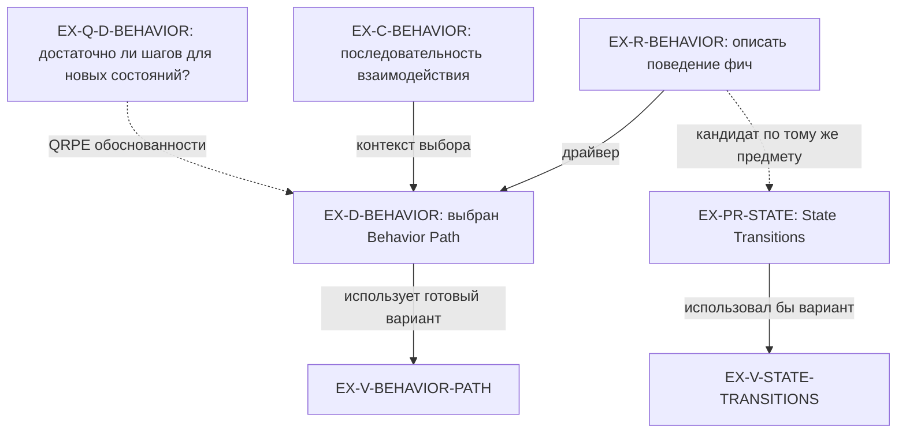
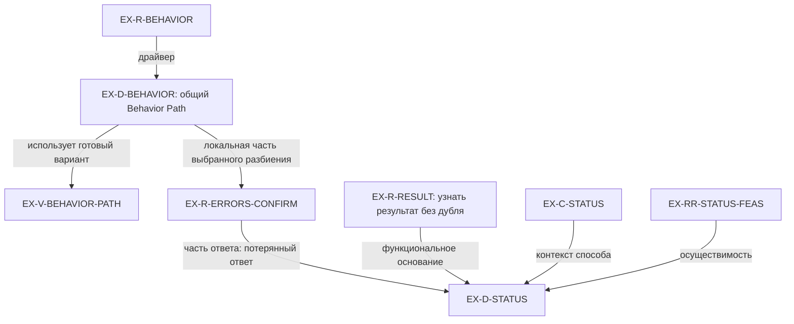

# Примеры графа Requirements–Decisions: App Definition

Версия: 0.2, 2026-10-10, Asia/Bangkok. Статус: иллюстративные примеры с применёнными уточнениями C-GEX-01.
Основа: 08-HANDOFF.md, M10–M13/M18/M21 и P01–P04/P08–P09/P11 из переданного архива; принятая карта отношений PR-GRC-004 и рабочая форма source PR-003.
Применены PR-GEX-001/003/004; commit COMMIT-GEX-20261010-01 по указанию пользователя «давай исправления по пропозалам». PR-GEX-002 сохранён как непринятая альтернатива.

## Краткий результат / Для пользователя

На примере приложения бронирования переговорных показаны пять проекций одного графа: разбиение плана, влияние контекста и Realization Requirements, делегация неизменного требования с внутренним ответом, выбор формата с альтернативами и QRPE, переход от контракта Behavior к локальному содержательному ответу. Источники потребностей теперь адресованы конкретным описаниям Scenario. Для проверки статуса явно показаны значимые предпосылки и граница достаточности при сохраняющейся неизвестности.

По исходному review: F-P-GEX-001 resolved применением PR-GEX-001; F-O-GEX-001 resolved применением PR-GEX-004; F-R-GEX-001 mitigated уточнением PR-GEX-003, реальный контракт проверки статуса не испытан. Эти статусы относятся к правкам иллюстрации и отдельно ведутся в актуальном review.

Выбранные решения внутри примеров относятся к условному приложению. Они не означают нового принятия этих решений пользователем для реального проекта. EX-* — метки примеров, а не выбранный формат файлов, API или обязательный набор типов узлов. Контексты и ссылки на Target Modules показаны как вспомогательные объекты; они не являются дополнительными Units.

Что читать:
- «1. App Definition» — семь соседних требований и содержательная связь сценариев с фичами.
- «2. Контекст и Realization Requirements» — как обстоятельства и нужды влияют на дополнительные требования и выбор границ.
- «3. Делегация и внутренний ответ» — один Requirement в двух местах и конкретная обработка потери ответа.
- «4. Готовый вариант, конкретный выбор, QRPE и пересмотр» — форма Behavior связана с локальным R обработки ошибок; варианты и материал QRPE сохраняются отдельно от принятия.
- «5. Общая область выбора» — одно общее решение по Behavior и разные локальные решения по состоянию.
- «6. Проверка по нашим сценариям» — что видно на примере и что требует дальнейшей проверки.

Ближайший шаг: сопоставить Behavior Path и State Transitions на одной обработке потери ответа, затем проверить, какие основания изменятся при новом существенном контексте. Точный формат физического графа остаётся дальнейшей работой.

## 0. Как читать примеры

Используются два независимых определения пользователя:
- Unit = Requirement.
- Выбор = driver → Decision. Драйвером может быть требование, контекст или используемое содержимое другого решения; любой драйвер не становится автоматически Requirement.

Сплошные стрелки на диаграммах подписаны по смыслу. Они не задают универсальную хронологию. Пунктир выделяет ссылки, варианты и материал проверки; это условность данных рисунков.

D — конкретный ответ в определённой области. Reusable variant — готовое описание способа, на которое этот ответ ссылается. Содержимое ответа на требование описать поведение не доказывает, что приложение уже реализовано и ведёт себя так.

Семь Units App Definition взяты из желаемой модели P01/M12. Это не утверждение, что в текущих файлах SDS уже реализованы все семь. Более точные контракты Scenario/Feature, виды функциональных Target Modules и responsibility/implementation owners здесь не выбираются.

## 1. App Definition: разбиение и содержательная зависимость

### Постановка и конкретные ответы

EX-R-PLAN: спланировать реализацию приложения бронирования переговорных, учитывая первую версию и известное развитие.
EX-C-APP: несколько сценариев, общие функциональные возможности, связанный интерфейс, известное будущее повторяющееся бронирование.
EX-D-APP: использовать структуру App Definition из семи Units. В условном примере выбрано; источник — P01/M12.

EX-D-APP задаёт следующее разбиение EX-R-PLAN. Все строки — соседние подреквайрменты одного родителя. Числа не означают порядок выполнения.

| Unit = Requirement | Что требуется |
| --- | --- |
| EX-R-CONCEPT | Сформулировать назначение, пользователей и границы приложения |
| EX-R-SCENARIOS | Определить нужные сценарии и передать их подробное описание соответствующим Scenario Target Modules |
| EX-R-ALTERNATIVES | Рассмотреть альтернативы и готовые решения по концепту и сценариям |
| EX-R-RR | Найти актуальные Realization Requirements и обеспечить консистентность решений |
| EX-R-FEATURES | Определить фичи исходя из потребностей сценариев |
| EX-R-WIDGETS | Определить UI-компоненты |
| EX-R-SCREENS | Определить экраны и их участие в сценариях |

Ниже проекция двух веток этого разбиения с подробным источником одной из потребностей.

EX-D-SCENARIOS: создание бронирования, отмена, просмотр доступности — для первой версии; повторяющееся бронирование — известный будущий сценарий. Это конкретный ответ по составу сценариев, а не название готового шаблона. Детальное описание выбранных сценариев передаётся вниз.

EX-D-FEATURES: выделить F-AVAILABILITY и F-RESERVATION, обслуживающие потребности нескольких сценариев. Это конкретное разбиение функциональности из P02.

| Первичный ответ / используемая часть | Часть ответа EX-D-FEATURES |
| --- | --- |
| EX-D-SCREATE: выбрать доступный слот | F-AVAILABILITY предоставляет доступность |
| EX-D-SCREATE: подтвердить бронирование и понять отказ | F-RESERVATION описывает подтверждение и отказ |
| EX-D-SCANCEL: отменить бронирование и увидеть результат | F-RESERVATION описывает отмену |
| EX-D-SLOOKUP: увидеть свободные интервалы | F-AVAILABILITY получает и представляет доступность |

EX-D-SCANCEL — краткий ответ на EX-R-DESCRIBE-CANCEL: описать сценарий отмены. Он описывает, как пользователь находит бронирование, отменяет его и видит результат. EX-D-SLOOKUP — краткий ответ на EX-R-DESCRIBE-LOOKUP: описать просмотр доступности. Он описывает, как пользователь задаёт комнату/время и получает свободные интервалы. Источник содержания — P02; новые EX-ID адресуют его в этом примере.

Parent EX-R-DESCRIBE-CREATE/CANCEL/LOOKUP — EX-R-SCENARIOS; дочерние R вводит EX-D-SCENARIOS. Подробный ответ создания описан в разделе 3; отмена и просмотр здесь представлены достаточными для этой проекции фрагментами. Все три описания используются в EX-D-FEATURES, каждое со своей частью. EX-D-SCENARIOS остаётся ответом о составе, а не агрегатом всех потребностей.

Для окончательного выбора границ нужны достаточно определённые потребности; предварительный кандидат можно обсуждать раньше. Использование части описания не требует завершить абсолютно все документы Scenario до начала любой работы над Feature.

Фичи не становятся дочерними модулями Scenario: требования к сценариям и фичам находятся в соседних ветках App Definition. При этом результаты одной ветки содержательно влияют на другую.

## 2. Контекст и Realization Requirements: чем обусловлены границы

### Контекст данного примера

Дополнительные значения EX-C-APP из P08:
- команда хочет независимо разрабатывать функциональные части;
- повторяющиеся бронирования — известное развитие;
- ресурсы первой версии ограничены.

Это контекст условного приложения. Форму его записи выбирает приложение/методология. Наличие поля, например количества разработчиков, само по себе не установило бы требование независимых слайсов.

EX-D-RR — ответ на EX-R-RR: в данном контексте найдены три актуальных требования, приведённые ниже. Они не становятся Fundamental Requirements модели графа.

| Найденное требование | Основание и нормативный смысл в примере | Где используется |
| --- | --- | --- |
| EX-RR-INDEPENDENT: обеспечить независимые слайсы функционала | Выведено в P08 из нужды команды в независимой разработке | При выборе границ Feature и их связей |
| EX-RR-EVOLUTION: известное добавление повторений не должно вынуждать полную перегруппировку фич | Выведено в P08 для известного развития, а не для любого гипотетического будущего | При проверке достаточности разбиения EX-D-FEATURES |
| EX-RR-FEASIBILITY: объём первой версии осуществим с текущими ресурсами | Выведено в P08 из ограниченных ресурсов | При выборе состава первой версии и проверке совместной осуществимости решений |

Диаграмма фокусируется на первом из этих требований.

У конкретного EX-D-FEATURES теперь видны разные основания:
1. Ответить на EX-R-FEATURES.
2. Обслужить конкретные потребности из EX-D-SCREATE/SCANCEL/SLOOKUP с указанными используемыми частями.
3. Удовлетворить актуальные Realization Requirements.

На уровне графа можно проследить эти основания. Для содержательного вывода о независимости нужны границы, договорённости между фичами и примеры изменения/разработки. Само название двух фич не доказывает независимость.

Пример проверки: если каждое изменение Reservation требует одновременного изменения Availability, ответ по EX-RR-INDEPENDENT нуждается в проверке. Здесь это контрпример для будущего исследования, а не утверждение о фактическом дефекте условного разбиения.

В графе полезно хранить, какая часть EX-D-FEATURES отвечает каждому актуальному R и чем это подтверждается. В данном примере подтверждена связь с потребностями из таблицы раздела 1, а фактическая независимая разработка остаётся непроверенной. Числовую оценку покрытия или агрегат делегаций пример не вводит.

## 3. Делегация неизменного Requirement и внутренний ответ

EX-R-DESCRIBE-CREATE: «Описать сценарий создания бронирования: контекст, действия пользователя, необходимые реакции и наблюдаемый результат».

Это дочернее требование, возникшее из ответа EX-D-SCENARIOS. Для его исполнения выбран Scenario S-CREATE. После передачи это тот же EX-R-DESCRIBE-CREATE, с тем же смыслом и формулировкой.

| Место | Что здесь представлено |
| --- | --- |
| App Definition / Scenarios | Постановка EX-R-DESCRIBE-CREATE, получатель Scenario S-CREATE и ссылка на результат |
| Scenario S-CREATE | Тот же EX-R-DESCRIBE-CREATE и его подробный ответ EX-D-SCREATE |

EX-TM-SCREATE на рисунке — ссылка на Target Module, не дополнительный Unit и не второе требование.

EX-D-SCREATE: пользователь выбирает комнату и время, подтверждает бронирование, получает определённый результат; если слот занят — понимает отказ и может выбрать другой. При потере ответа нужна понятная обработка неопределённого результата.

EX-R-RESULT: после потери ответа пользователь должен узнать результат подтверждения без создания дублирующего бронирования. Это функциональное требование к желаемому поведению; оно отличается от требования написать описание. Связка подробного Scenario с локальным ответом Feature — иллюстративная композиция P02/P03/P09, а не утверждение окончательного соответствия всех слотов SDS.

EX-C-STATUS из P09: в условном проекте уже доступен способ проверить статус подтверждения; ресурсов на новую подсистему нет.

Значимые переменные данного контекста пока не подтверждены: можно ли связать статус с тем же подтверждением; какие ответы окончательны; может ли средство установить результат после потери ответа. Это вопросы к конкретному способу, а не универсальная форма Context и не автоматически новые Fundamental Requirements.

EX-RR-STATUS-FEAS из P09: обработка должна быть осуществимой с доступными средствами и ресурсами. Это локальный Realization Requirement, отдельный от функционального EX-R-RESULT.

EX-D-STATUS: показать, что результат пока неизвестен; использовать доступную проверку статуса нужного подтверждения; после установленного окончательного результата показать подтверждение или отказ. Промежуточный ответ «обрабатывается / неизвестно» сохраняет неизвестность: он не превращается в отказ. Повторное создание не предлагается как автоматический способ получить ответ. Это конкретный локальный ответ внутри проработки F-RESERVATION.

| Условие / ответ средства | Ответ в примере | Что можно заключить |
| --- | --- | --- |
| Статус связан с нужным подтверждением и результат окончателен | Показать подтверждение или отказ | Эта ветка даёт результат; реальные свойства средства требуют проверки |
| Ответ промежуточный либо результат ещё неизвестен | Сохранять понятную неизвестность | EX-R-RESULT ещё не получил полного ответа |
| Связь с подтверждением или возможность установить результат не выяснена | Оставить открытым вопрос достаточности способа | Нужен контракт/evidence; нельзя объявить весь EX-R-RESULT обеспеченным |

EX-Q-D-STATUS: относится ли статус к тому же подтверждению, различает ли окончательный результат и неизвестность, можно ли установить результат после потери ответа? Это вопрос QRPE обоснованности EX-D-STATUS. Он partially blocking только положительное заключение о достаточности этого способа и его реализацию; описание и обсуждение графа продолжаются. Закрывается контрактом и проверкой реального средства либо явными предпосылками условного примера, которые не доказывают факты приложения. Само появление вопроса не отменяет выбранный D.

Такой ответ не обязан порождать дальнейшее разбиение, если на данном уровне он уже достаточно содержателен. Условие достаточности по EX-R-RESULT теперь раскрыто; выбор алгоритма, deadline получения результата и runtime-тестирование остаются дальнейшей реализацией. Полная защита всех повторных обработок этим бумажным примером не доказана.

Здесь одновременно видны:
- происхождение дочернего R из выбранного разбиения;
- делегация прежнего R, не создание его копии;
- содержательный ответ на описание;
- функциональная потребность из описания;
- локальное решение с контекстом и реализационным ограничением.

Передача требования не означает его выполнения. Расчёт покрытия делегаций в данный прогон не входит.

## 4. Готовый вариант, конкретный выбор, QRPE и пересмотр

### Исходный выбор

EX-R-BEHAVIOR: описывать действия, реакции, ошибки и правила поведения фич приложения.
Scope данного примера: Behavior всех Feature Target Modules в одном приложении, как в P04.

Два готовых варианта из P03:
- EX-V-BEHAVIOR-PATH — Behavior Path: описание по шагам взаимодействия, с действиями, реакциями, ошибками и инвариантами.
- EX-V-STATE-TRANSITIONS — State Transitions: состояния, события, условия, переходы и эффекты.

EX-C-BEHAVIOR: сейчас нужно описать последовательность подтверждения; шаги взаимодействия дают удобную основу.
EX-D-BEHAVIOR: в указанном scope использовать Behavior Path. Выбрано в условном примере.
EX-PR-STATE: выбрать State Transitions как основную структуру того же описания. Рассмотренный, не выбранный кандидат в исходном контексте; origin: пример P03. Не объявляется запрещённым вообще.

Конкретный D содержит ответ «здесь использовать этот вариант», основания и scope. Каталожный вариант содержит переиспользуемое описание способа и один или несколько расширяемых канонов уместности.

Каноны помогают сопоставить реальную ситуацию с вариантом. Если один канон не перечислил существенное обстоятельство, можно расширить его или рассмотреть другой канон. Это само по себе не дефект графа и не отмена выбора. Совпадение с каноном не заменяет проверки реальных требований.

### От выбранного контракта к локальному ответу

Слот ошибок выбранного Behavior Path задаёт EX-R-ERRORS-CONFIRM: определить ожидаемые ошибки подтверждения и требуемую обработку. Parent — EX-R-BEHAVIOR; структурное происхождение — EX-D-BEHAVIOR и выбранный Behavior Path. Scope под-R — подтверждение в F-RESERVATION.

EX-D-STATUS одновременно заполняет часть локального описания ошибок и отвечает на функциональную потребность Scenario, с оговорённой в разделе 3 границей достаточности. Это тот же D, а не копия ответа. Обработка занятого слота — другая часть EX-R-ERRORS-CONFIRM: показать отказ и возможность выбрать другой слот, как в P03. Эта проекция не объявляет весь список ошибок закрытым.

Общий EX-D-BEHAVIOR остаётся одним решением о форме. Локальный под-R не вводит новый Target Module, owner или обязательное дальнейшее разбиение каждого элементарного ответа.

### Разные предметы QRPE

| Запись | Объект и вопрос | Что изменит результат рассмотрения |
| --- | --- | --- |
| EX-Q-R-INDEPENDENT из раздела 2 | Необходимость EX-RR-INDEPENDENT: действительно ли команде нужна независимая разработка, или нужна лишь простота изменения и понятные границы? | Подтверждение/уточнение самого R и пересмотр затронутых оснований EX-D-FEATURES |
| EX-Q-D-BEHAVIOR | Обоснованность EX-D-BEHAVIOR: выбранный способ по шагам достаточен ли в новом контексте? | Подтверждение прежнего способа, уточнение ответа или подготовка другого состава |
| EX-Q-D-STATUS из раздела 3 | Обоснованность EX-D-STATUS: может ли доступная проверка установить результат нужного подтверждения? | Проверка границы достаточности локального способа; при подтверждённом ограничении — его содержательный пересмотр |

Эти записи — Questions внутри QRPE, а не отдельные committed решения. Пока нет проверенных противоречий, не заполняем Problems ради полноты таблицы.

### Условное изменение контекста

Следующее изменение добавлено для эксперимента самим ассистентом: появляются существенные реакции на внешние события, зависящие от текущего состояния бронирования. Это EX-C-BEHAVIOR-NEW, origin assistant/example extension; не новая установленная нужда реального пользователя.

В этой ситуации разумно сравнить:
- EX-PR-HYBRID — сохранить Behavior Path и добавить описание переходов там, где оно действительно требуется. Pending в условном пересмотре. Плюс: сохраняется понятная последовательность; цена: нужно поддерживать согласованность двух представлений.
- EX-PR-STATE — пересмотреть прежнюю оценку State Transitions как основного способа. Pending, вновь рассматриваемый вариант. Плюс: состояния и внешние события выражены непосредственно; цена: нужно сохранить связь с пользовательскими действиями и адаптировать существующие описания.

Это варианты одной локальной развилки. Не установлено универсальное правило, что Behavior Path и State Transitions всегда взаимно исключают друг друга. Точный выбор зависит от требуемого содержания и цены согласования/переделки.

Cost / Timing Delta — качественный:
- База: принятый в примере Behavior Path, уже имеющиеся описания.
- Hybrid: меньше замены существующих текстов, но появляется повторяющаяся работа по согласованности двух форм.
- Основной State Transitions: больше пересмотра структуры существующих описаний, потенциально меньше неоднозначности в поведении по состояниям.
- Временные и денежные значения, сроки готовности и quantitative delta unknown: нет измерений, окончательных контрактов и реального объёма описаний.
- Обе формы можно проверить на одном проблемном фрагменте поведения до распространения на все фичи. Это способ сравнения в примере, а не молчаливое изменение обещанного объёма проекта.

### Логические связи отдельно от истории принятия

| Запись истории условного примера | Что произошло | Что остаётся видимым |
| --- | --- | --- |
| EX-E1 | В исходном EX-C-BEHAVIOR принят EX-D-BEHAVIOR, scope — Behavior всех Feature TMs данного приложения | Принятый ответ, исходный контекст, R, готовый вариант, причины невыбора State Transitions |
| EX-E2 | Появился EX-C-BEHAVIOR-NEW и QRPE-вопрос | EX-E1 сохраняется; вопрос и изменение контекста не означают нового принятия |
| EX-E3 | Подготовлены EX-PR-HYBRID и повторная оценка EX-PR-STATE | Оба кандидата отделены от действующего принятого ответа |
| Следующая запись, только при фактическом принятии | Фиксируется точный новый состав и область изменения | Предыдущий ответ и его основания сохранены; видно, что именно изменилось |

EX-E1–03 — последовательность событий придуманного примера. Это не восстановленная реальная хронология P03/P04 и не даты изменений файлов.

Граф оснований отвечает «почему и откуда». История принятия отвечает «что было принято раньше и что действительно изменилось потом». Отсортировать стрелки или файлы недостаточно для второго вопроса.

## 5. Общая область выбора и разные локальные ответы

Тот же пример можно расширить по P04, не размножая EX-D-BEHAVIOR для каждой фичи.

| Предмет выбора | Scope | Конкретный ответ |
| --- | --- | --- |
| EX-R-BEHAVIOR | Behavior всех Feature Target Modules данного приложения | Один общий EX-D-BEHAVIOR: использовать Behavior Path |
| EX-R-STATE-RESERVATION: описать состояние бронирования | Только F-RESERVATION | EX-D-STATE-RESERVATION: таблица состояний |
| EX-R-STATE-SELECTION: описать состояние выбора комнаты и времени | Только соответствующая фича/часть функционала | EX-D-STATE-SELECTION: простой список данных |

Общее решение о форме Behavior не означает одинаковое поведение всех фич. Локальная таблица состояния Reservation не отменяет автоматически общий выбор Behavior Path: предметы этих решений различны.

Последние строки иллюстрируют варианты P04. Они не вводят новый обязательный Target Module «State», профиль исключений или классификацию owners.

## 6. Проверка по нашим сценариям

Это смысловой прогон по бумажным примерам. Извлечение графа из реальных файлов, работа визуального навигатора и поведение приложения здесь не испытаны.

| Наш Desired Scenario | Что можно пройти на примере | Граница результата |
| --- | --- | --- |
| SC-RDG-01: общая картина | EX-R-PLAN → разбиение → описания Scenario → Feature; EX-R-BEHAVIOR → контракт → локальный R → EX-D-STATUS | Не показан весь корпус приложения |
| SC-RDG-02: последовательность | EX-E1 → EX-E2 → EX-E3 с прежними основаниями | История условная, не реальная хронология источников |
| SC-RDG-03: драйверы | Открыть EX-D-FEATURES и увидеть EX-R-FEATURES, части EX-D-SCREATE/SCANCEL/SLOOKUP и RR | Достаточность границ для независимой разработки не доказана |
| SC-RDG-04: варианты | Сопоставить Behavior Path и State Transitions с контекстом; затем пересмотреть кандидаты | Каноны и пример не выбрали окончательный способ в новом контексте |
| SC-RDG-05: достаточность ответа | По конкретной потребности увидеть часть ответа; различить окончательный статус, промежуточный ответ и открытые предпосылки | Нет числовой метрики и расчёта покрытия делегаций; runtime не проверен |
| SC-RDG-06: актуальность | Разделить QRPE необходимости R и обоснованности D | Ответы на QRPE-вопросы требуют содержательной проверки |
| SC-RDG-07: пересмотр | Вернуться к сохранённому кандидату и сопоставить два новых состава | Новый состав в условной развилке пока pending |
| SC-RDG-08: обновление из файлов | Понять, какой внутренний R/D и происхождение должны попасть в проекцию | Программное извлечение в этой работе не выполнено |
| SC-RDG-09: контекст для чата | Собрать R, конкретный D, scope, контекст, варианты и QRPE по нужному вопросу | Эффективность сокращения и ответа чата не измерена |

### Что стоит проверить следующим на этих же данных

1. Взять обработку потери ответа из EX-D-STATUS и разложить Behavior Path и State Transitions на одинаковом содержании, включая неизвестность и условия достаточности.
2. Изменить одну потребность EX-D-SCREATE, сохранив состав EX-D-SCENARIOS, и проверить, какая часть EX-D-FEATURES нуждается в рассмотрении.
3. Посмотреть, что изменилось в EX-C-BEHAVIOR-NEW, какие R остались нужными и какой конкретный D требует рассмотрения.
4. После этого пробовать физическое представление небольшого фрагмента в файлах, сохраняя принятые ответы отдельно от latest definitions.

Эти действия не требуют заранее мигрировать всю методологию. Отдельное решение о точных форматах, источниках и сборке остаётся последующей работой.

## 7. Источники, происхождение и запись прогона

### Карта источников

| Содержание | Основание |
| --- | --- |
| Семь соседних Units App Definition; Features исходят из нужд Scenario | 01-MODEL.md M11–M13; 02-POSITIVE-EXAMPLES.md P01–P02 |
| Два способа описания Behavior и содержательный внутренний ответ | P03 |
| Общий Behavior и индивидуальный выбор другого Unit | M10; P04 |
| Контекст независимой разработки, известного развития и ресурсов | P08 |
| Локальная обработка потери ответа с доступной проверкой статуса | P09; содержание ошибок/инвариантов P03 |
| QRPE необходимости R отдельно от QRPE обоснованности D | M21; P11 |
| Один R при делегации; конкретный D со scope; достаточная история | Принятый состав C-GRC-DEC-01 и карта PR-GRC-004, раздел 6.3 актуальных clarifications |
| Связка подробного Scenario с локальным ответом; новый контекст внешних событий; hybrid-кандидат; EX-E1–03 | Иллюстративная композиция/дополнение ассистента, не новый commit реального проекта |
| Прямые источники потребностей, условия достаточности EX-D-STATUS и локальная ветка ошибок Behavior | PR-GEX-001/003/004 из review; приняты и применены в C-GEX-01, COMMIT-GEX-20261010-01 |

Полные исходные файлы находятся в переданном workspace. Их имена и секции указаны для поиска; адреса GitHub или несуществующие ссылки не сконструированы.

### EX-LOG-01 — запись прогона

Target: примеры Requirements–Decisions графа на App Definition.
Версия записи: документ v0.1 до применения C-GEX-01; принятая рабочая семантика C-GRC-DEC-01 сохранена. Следующая запись отражает изменения v0.2.
Итог: представлены четыре связанные проекции и отдельная таблица общего/локального scope; сопоставлены SC-RDG-01–09.
Изменение принятого состава: отсутствует; EX-* — примеры.
Новые подтверждённые Findings: не заявлены; это не независимый review всего корпуса.
Открытый выбор внутри гипотетического примера: EX-PR-HYBRID / EX-PR-STATE, pending; блокирует лишь утверждение нового способа Behavior в новом условном контексте, не построение/обсуждение этих примеров.
Evidence gaps: runtime-достаточность, независимая разработка выбранных слайсов, извлечение из реального Markdown, точная стоимость вариантов и реальная хронология не проверены.
Deferred scope: owners, детальные профили/исключения, новые функциональные Target Modules, покрытие делегаций и миграция методологии. Возврат — при отдельно согласованной проработке соответствующего уровня.
Следующий шаг: сравнить два способа на одном конкретном внутреннем ответе, затем выбрать небольшой физический образец графа.

### EX-LOG-02 — применение C-GEX-01

Дата: 2026-10-10, Asia/Bangkok. Версия документа: 0.2.
Commit: COMMIT-GEX-20261010-01; C-GEX-01 COMMITTED. Основание: пользователь «давай исправления по пропозалам» после meta-review рекомендованной композиции.
Точный состав: PR-GEX-001/003/004 committed и применены. PR-GEX-002 pending, non-selected alternative. Граница commit — уточнение иллюстраций; условные EX-D приложения не становятся реальными решениями проекта.
Результат: пять проекций; источники выбора Feature — конкретные описания Scenario; от общего Behavior появился путь к локальному R ошибок и прежнему EX-D-STATUS; неизвестность и предпосылки статусного способа обозначены явно.
Findings source review: F-P-GEX-001 resolved, F-O-GEX-001 resolved, F-R-GEX-001 mitigated в пределах описания примера; runtime-проверка не выполнена. Актуальные canonical записи — в requirements-decisions-graph-examples-v0.1-review.md; здесь только индекс.
Открытый вопрос: EX-Q-D-STATUS partially blocking достаточность и реализацию данного способа в реальном проекте; EX-PR-HYBRID / EX-PR-STATE остаются pending в условном новом контексте.
Evidence gaps и deferred scope предыдущей записи сохраняются. Следующий шаг: сопоставить два формата на одной обработке, затем выбрать физический образец.
